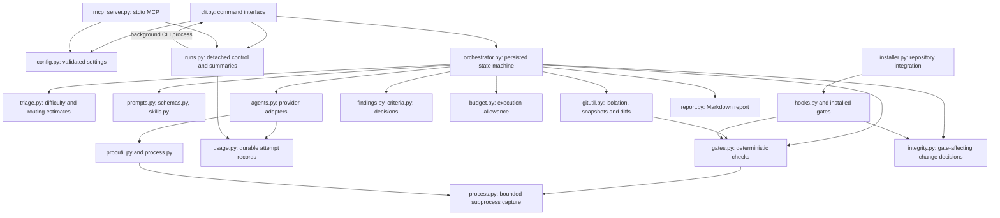
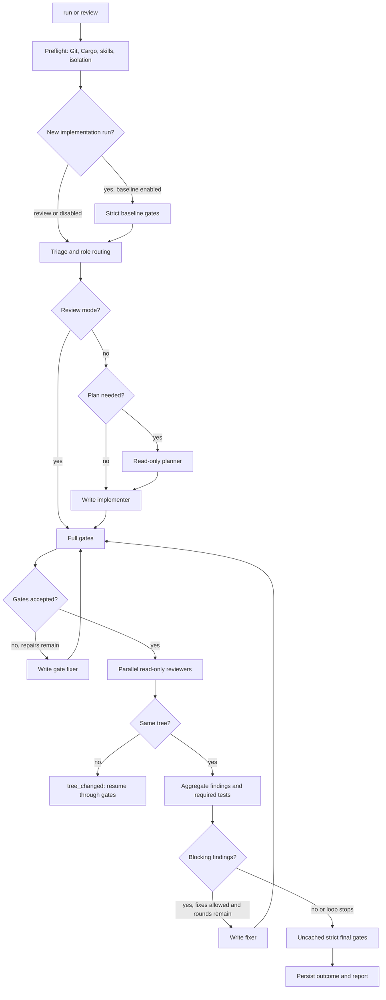

# Architecture

rustflow is a Python command-line orchestrator for Rust repositories. It launches the installed Claude Code and Codex CLIs, evaluates their output locally, runs Cargo quality gates, and persists enough state to inspect or resume a run. The Python package uses the standard library; Git, the Rust toolchain, and provider CLIs are external processes.

See [usage](usage.md) for commands, [configuration](configuration.md) for settings, and [troubleshooting](troubleshooting.md) for recovery.

## Modules and dependencies

The main implementation is in [`rustflow/`](../rustflow/). The arrows below show the principal runtime relationships, rather than every import.

| Module | Responsibility |
| --- | --- |
| [`cli.py`](../rustflow/cli.py), [`__main__.py`](../rustflow/__main__.py) | Parse commands and options, select a repository, load configuration, dispatch work, and return exit codes. |
| [`mcp_server.py`](../rustflow/mcp_server.py) | Expose triage, start, wait, status, report, cancel, resume, and gates through a standard-library stdio MCP server. |
| [`config.py`](../rustflow/config.py) | Load packaged defaults and project overrides; validate model allowlists, role specifications, and execution limits. |
| [`orchestrator.py`](../rustflow/orchestrator.py) | Own phase transitions, run state, agent calls, gates, review aggregation, fix loops, and final outcomes. |
| [`triage.py`](../rustflow/triage.py) | Classify difficulty, map roles to configured models, and estimate Claude costs from repository run history. |
| [`agents.py`](../rustflow/agents.py) | Build provider-specific commands; compose prompts; parse and validate outputs; retry eligible failures; track each provider invocation. |
| [`prompts.py`](../rustflow/prompts.py), [`schemas.py`](../rustflow/schemas.py), [`skills.py`](../rustflow/skills.py) | Define role context, structured contracts, and deterministic loading of installed project skills. |
| [`gitutil.py`](../rustflow/gitutil.py) | Resolve bases, create branches/worktrees, create snapshots including untracked files, calculate diffs and risk signals, and make optional checkpoint commits. |
| [`gates.py`](../rustflow/gates.py) | Run formatting, compilation/linting, tests, and optional policy checks; parse diagnostics and test names; cache successful checks by tree fingerprint. |
| [`findings.py`](../rustflow/findings.py) | Validate anchors, merge duplicate findings, preserve IDs, apply blocking/confidence rules, and manage disputes without another model call. |
| [`criteria.py`](../rustflow/criteria.py) | Load acceptance criteria and prove named tests from current gate output independently of reviewer claims. |
| [`integrity.py`](../rustflow/integrity.py) | Standalone, copied to `.rustflow/` like the gate code. Pipeline: scan the base-to-tree diff for gate-affecting changes, reconcile them with earlier decisions, prove `config` and `silence` changes by rerunning gates, apply reviewer votes for `cargo-lints` and `tests-removed`, then decide which changes are accepted. |
| [`budget.py`](../rustflow/budget.py) | Persist physical attempt counts and active wall time; reserve initial parallel reviewer slots and enforce execution limits. |
| [`usage.py`](../rustflow/usage.py) | Normalize provider measurements, atomically write attempt records, and distinguish known measurements, missing data, and timeout estimates. |
| [`process.py`](../rustflow/process.py), [`procutil.py`](../rustflow/procutil.py) | Capture bounded UTF-8 subprocess output, enforce deadlines/cancellation, kill process trees, resolve Windows npm shims, and scrub inherited agent-session variables. |
| [`runs.py`](../rustflow/runs.py), [`report.py`](../rustflow/report.py) | Control detached processes and repository ownership, locate runs, produce concise machine-readable summaries and `next_actions`, and render full reports. |
| [`installer.py`](../rustflow/installer.py), [`hooks.py`](../rustflow/hooks.py), [`doctor.py`](../rustflow/doctor.py), [`lints.py`](../rustflow/lints.py) | Install repository assets, connect interactive hooks, diagnose the environment, and adopt lint rules already satisfied by the code. |

`rustflow init` copies standalone gate and process code into the target repository. Hooks, the orchestrator, and generated CI therefore use the same gate implementation. These copies are installed assets: rerun `init` with the appropriate overwrite options when updating an existing integration. The standalone scripts support Python 3.9+, while the CLI requires Python 3.11+; loading TOML under older standalone interpreters requires `tomli`, otherwise gate defaults apply.

## From a command to a report

The central state machine is `Orchestrator` in [`orchestrator.py`](../rustflow/orchestrator.py). A new run creates `.rustflow/runs/<run-id>/`, acquires repository ownership, writes the task and initial state, then enters the phase loop.

Error, interruption, and execution-limit exits can occur in any phase. Report-only review also proceeds to reviewers when initial gates are red, passing the gate output as context; it does not run a fixer or rewrite formatting. Its intermediate Cargo checks are unlocked and can generate/update a lockfile; final checks are strict.

1. **Preflight and isolation.** Git must be available, and `Cargo.toml` must exist under `gates.cargo_dir`. Implementation runs normally require a clean checkout and use the configured `branch`, `worktree`, or `none` isolation. Review defaults to `none` and permits existing changes. For a non-`HEAD` review base, rustflow resolves the merge base with `HEAD`. Worktree runs share the main checkout's `target/` through `CARGO_TARGET_DIR`. Gate configuration is read from `rustflow.toml` at the base commit and frozen in the run state, so resume uses the same values.
2. **Baseline.** Implementation runs check the starting code by default. A red baseline stops before agent work unless explicitly accepted. Accepted failures are compared by diagnostic signatures; unitemized failures cannot be proven pre-existing. A stopped preflight undoes newly created isolation where possible, retaining generated lockfile information needed for safe resume.
3. **Triage and optional plan.** A CLI difficulty override wins. Otherwise heuristics, optionally an LLM or hybrid classification, select the role specifications. Review triage also considers diff size and unsafe/FFI/atomic signals. Planning defaults to hard implementation tasks. A failed planner can fall through to implementation without a plan.
4. **Implementation and gates.** A write agent edits the isolated checkout. Its narrative report is informational: the resulting Git tree and gate results determine progress. A failed write call that changed files proceeds to gates; a failed unchanged call becomes resumable `agent_failed`. No changes after a successful implementation yields `no_changes`. Red gates get a bounded repair loop before review; subsequent gate repairs can use a harder fixer specification. After green gates, the orchestrator scans for gate-affecting changes and proves the provable ones.
5. **Independent review.** Reviewers run concurrently against a recorded tree. They receive the task, acceptance criteria, risk signals, gate summary, diff context, and earlier blocking findings. Large re-reviews can use the delta from the previous review tree. Risk signals force hard reviewer routing and can enable an optional auditor. `rereview = "first"` deliberately schedules only the first reviewer in later rounds.
6. **Aggregation and fixing.** Local code validates and merges findings, applies policy, and adds mechanical findings for missing required tests. Unaccepted gate changes become blocking `G-<kind>-<path>` findings that reviewers and the fixer cannot close. When only those findings remain after a fix round, the run ends as `gate_changes_pending`. Open findings lead to a fixer if permitted. Unchanged or oscillating fixes and repeated unresolved findings can stop as `stalled`; round limits stop as `max_rounds`. Fixes return through gates before review.
7. **Final verification and report.** Final gates are a strict, uncached full check, with formatting in check mode and `--locked` when a lockfile exists. Accepted baseline signatures still apply. Approval requires accepted final gates and proven required tests. Approval also requires every gate change to be accepted. Advisory or disputed findings, or any accepted gate change, produce `approved_with_advisories`. The report includes routing, findings, costs, attempts, and next steps.

Final orchestration gates and standalone CI use the same engine but different modes: `gates.py ci` additionally enables CI behavior, such as running environment-conditional extras regardless of the variable and checking configured cargo-deny policy regardless of manifest changes. A local final check does not set `ci=True`.

## Agent contracts and retry boundaries

[`agents.py`](../rustflow/agents.py) defines `AgentCall` and `AgentResult` as the provider boundary. Calls carry role, requested model/effort, prompt, working directory, permissions, schema, timeout, and budget context. Claude uses `claude -p` JSON output; Codex uses `codex exec --json`, an optional output schema, and a last-message artifact. Structured outputs are revalidated locally through [`schemas.py`](../rustflow/schemas.py).

Prompts go through stdin to avoid command-line length and quoting problems. On Windows, supported npm shims are resolved to `node <script>` where possible. Provider children receive isolated session identity while authentication/provider environment variables remain available. Read-only and write roles use separate tool permissions or Codex sandboxes. These mechanisms complement installed hook guards; they do not make arbitrary repository commands free of side effects.

Eligible transient failures get one retry. Authentication, unavailable models, unsupported CLI flags, timeouts, incomplete capture, and provider budget/turn stops are excluded. Write-role retries additionally require an unchanged tree. Claude can repair missing structured output once by resuming the same provider session with a JSON-only request; a failed repair does not trigger another retry. Initial failure, retry, and repair remain separately recorded attempts.

The requested and observed models are separate fields. Claude's observed model is selected from `modelUsage` by greatest output contribution. A mismatch is logged and reported rather than silently replacing the requested routing metadata.

## Deterministic decisions

The implementation keeps mechanical evidence outside the model's verdict:

- **Findings:** [`findings.py`](../rustflow/findings.py) normalizes paths, drops nonexistent file anchors, downgrades confidence for invalid lines, merges similar cross-reviewer findings, and retains alternative descriptions. Repeated findings keep IDs for escalation and progress detection. P0 bypasses severity/confidence filtering; other severities follow `loop.block_on`, with a confidence threshold for findings from only one reviewer. After two rejected-and-raised-again disputes, a finding becomes `disputed` for human decision, including a P0 finding.
- **Required tests:** [`criteria.py`](../rustflow/criteria.py) checks parsed `tests` and `doctests` output. At least one matching test must pass and no matching test may fail. Exact paths and suffix names are supported, including nextest binary-qualified names. A short name matching several tests requires all observed matches to pass. Ignored tests, zero-test success, reviewer assertions, skipped steps, and incomplete output cannot prove a criterion. Missing evidence creates a blocking `T-<criterion-id>` finding.
- **Tree identity:** Git snapshots include relevant tracked and untracked files, excluding runtime artifacts. Full gates check that commands did not change source files after formatting; a lockfile may change only when the check is not locked. A review whose checkout changes is discarded and resumes through gates on the new tree. Successful gate cache entries describe a particular fingerprint; strict checks and mechanical-criteria checks bypass cache.
- **Gate-affecting changes:** [`integrity.py`](../rustflow/integrity.py) turns each unaccepted change into a blocking `G-<kind>-<path>` finding that reviewers and fixers cannot close. Changes that are provable are accepted only by a green proof; reviewer votes are required for `cargo-lints` and `tests-removed`. When only `G-` findings remain, the run ends as `gate_changes_pending`, which is not approved and can be resumed with `rustflow resume` after the change is reverted by hand.
- **Degraded review:** An ordinary failure of one reviewer can leave a usable result from another. The summary records failed planned reviewers and suggests another review before merge. An execution-limit/incomplete-output failure instead stops the run; it cannot be converted into approval by the surviving reviewer.

## Durable state and execution limits

[`runs.py`](../rustflow/runs.py) maintains `.rustflow/runs/ACTIVE.json` with the run ID, PID, and checkout information. The lock prevents a second run and lets installed hooks protect a checkout used by an active run. PID checks distinguish an active process from a stale running state. Detached starts write process output to `console.log`; status/wait/report use the same persisted state and `next_actions` protocol as MCP.

Phase transitions and agent results are saved to `state.json` using a temporary file and atomic replacement. A heartbeat persists execution time once per second. Resume restores saved options and phase, reconciles the attempt ledger, checks branch/worktree availability, and preserves finding IDs and checkpoints. It resumes the state machine; the ledger itself does not decide which actions to replay. A phase interrupted before its transition may run again, with new attempt identities and preserved earlier evidence.

[`budget.py`](../rustflow/budget.py) enforces three independent execution limits: physical provider attempts, active wall time across resumed sessions, and combined raw stdout/stderr bytes per subprocess. Retry and JSON repair each spend an attempt slot. Initial reviewer calls reserve their group before launch, so fast retries cannot consume another reviewer's initial slot. Only durable attempt records spend slots; failed admission creates no phantom provider record. Offline time between sessions is excluded; a crash with an open session adds one second of estimated time after the last heartbeat. Resume preserves saved limits and permits explicit increases only.

[`process.py`](../rustflow/process.py) drains stdout and stderr concurrently into a shared bounded byte allowance, checks deadlines and cancellation while polling, and kills process groups on POSIX or process trees with `taskkill` on Windows. A local timeout, shared deadline, output overflow, or pipe failure marks output incomplete even if its prefix looks like valid JSON. Incomplete gates cannot populate the successful cache or prove named tests.

The separate Claude monetary budget is described below. It is checked before logical calls, rather than reserving a new USD allowance for every retry or repair.

## Attempt ledger and usage semantics

One logical role call is one entry in `state.agents`; each provider CLI invocation is a separate atomically persisted `attempts/<attempt-id>.json` record. A record starts before invocation and finishes with its outcome. Its kind is `initial`, `retry`, or `json_repair`, and it carries the logical-call ID, role, requested model, timestamps/duration, raw usage, normalized counters, measured cost, separate estimate, termination metadata, and artifact paths. The logical entry links these records through `attempt_ids`.

The final attempt determines the logical result. Duration, costs, and token counters accumulate across every attempt, including failures. Preparation failures such as a missing executable do not create provider attempts. Dry-run writes prompts/commands without provider attempts.

### Booked cost versus measured usage

`state.cost_usd` retains its budget-accounting meaning: known measured costs from **all Claude attempts**, plus role-cap estimates booked for Claude timeouts, plus any legacy baseline. Codex currently reports tokens without measured USD. This field is therefore not a measured combined-provider bill. `budget.max_total_usd` is checked before a logical call; retries and JSON repair reuse the call's provider budget arguments and do not receive a fresh monetary reservation. Concurrent calls can already be in flight when a total is reached.

`usage_summary` has `schema_version = 1` and appears in state, CLI JSON, and MCP summaries:

| Field or concept | Meaning |
| --- | --- |
| `attempt_count` | Number of recorded physical attempts. |
| `history_complete` | Whether the full attempt history is known, rather than a legacy baseline. |
| `cost_usd.known` | Sum of valid measured costs that are present. |
| `cost_usd.total` | Complete measured total, or `null` if any attempt lacks cost or history completeness is unknown. |
| `missing_attempts` | Number of recorded attempts lacking that measurement; it does not count unknown legacy attempts. |
| `estimated_cost_usd` | Timeout estimates only, kept separate from measurements. |
| Provider `tokens.<counter>` | The same `known`, `total`, and `missing_attempts` structure for normalized token counters. |
| `measurements.complete` / `partial` / `unknown` | Counts of attempts with cost and all provider counters, some measurements, or no measurements. |

An explicit numeric zero is a measurement. Missing fields, wrong types (including booleans), negative values, NaN, and infinity are not. Token counters additionally require integers. Codex cached input is already included in `input_tokens`; Claude's cache creation/read input counters are separate and included in its token total. Missing Claude cache counters make that total incomplete. Legacy `tokens` remains available, but cross-provider comparisons should use normalized provider fields in `usage_summary`.

The full report lists individual attempts; brief and MCP status/JSON expose aggregates. Compatibility paths such as `agents/<name>.result.json` show the latest result. Ledger references point to unique files containing attempt IDs, so another call or resume does not overwrite the earlier attempt's artifacts.

On resume, finished attempt records keep their IDs and artifacts. A record left `started` by the previous process becomes `interrupted` with unknown measurements. Aggregates are recomputed from the ledger, avoiding double counting when a process died after writing a result but before updating state. Old runs remain readable without migration; resume preserves their previous booked cost and raw token counters in `usage_baseline`, with unknown history completeness instead of manufactured attempts.

For new histories, triage cost estimation uses complete measured **Claude cost** samples, including zero; it excludes unknown costs and timeout estimates. Legacy history remains available with its completeness explicitly unknown.

## Why these boundaries exist

These choices are directly reflected in implementation and tests:

- Gates run before review so reviewers normally see compiling, tested changes; the report-only path preserves evidence even for red changes.
- Local aggregation and named-test checks give consistent decisions across model outputs and prevent a narrative approval from substituting for mechanical evidence.
- Separate logical calls and physical attempts preserve the user-facing workflow while accounting for paid failed work and recovery.
- Bounded process capture and durable execution allowances let limits stop work without treating truncated evidence as success.
- Persistent phases, Git snapshots, and checkpoint commits retain useful work after failure and support continuation in the same branch or worktree.
- Standalone standard-library gate scripts allow the same checks to run from hooks and CI without installing the complete CLI there.

Useful executable references are [`test_e2e.py`](../tests/test_e2e.py), [`test_attempts.py`](../tests/test_attempts.py), [`test_usage_state.py`](../tests/test_usage_state.py), [`test_execution_budget.py`](../tests/test_execution_budget.py), [`test_limit_flow.py`](../tests/test_limit_flow.py), [`test_process_limits.py`](../tests/test_process_limits.py), [`test_criteria.py`](../tests/test_criteria.py), [`test_tree_stability.py`](../tests/test_tree_stability.py), and [`test_degraded_review.py`](../tests/test_degraded_review.py).
